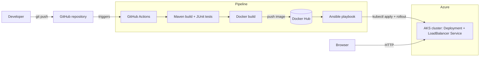

# Campus Carpool Matcher - end-to-end CI/CD on Azure

A Spring Boot web application that matches students who need a ride with drivers going the same way
(for example Tambaram to Shiv Nadar University Chennai), delivered through a fully automated
**Git -> Maven -> Docker -> Kubernetes (AKS)** pipeline.

## Architecture



## What the application does

* Drivers publish rides (from, to, departure time, seats).
* Riders search by route, preferred time and flexibility and get ranked matches.
* Matching: a ride is a candidate when it has a free seat, its pickup is within 6 km of the rider's origin,
  its drop-off is within 6 km of the rider's destination and it leaves inside the rider's time window.
  `score = 100 - 8*pickupKm - 8*dropKm - 0.5*minutesFromPreferredTime` (haversine distances).
* Booking reduces the seat count; a full ride returns 409, a driver cannot book their own ride, and a rider cannot book twice.
* The page footer shows **version, build (git commit), environment and pod name**, which proves what is running after a deployment.

## Repository layout

| Path | Purpose |
|---|---|
| `src/main`, `src/test` | Application code and JUnit tests |
| `pom.xml` | Maven build (produces `target/app.jar`) |
| `Dockerfile`, `.dockerignore` | Container image (non-root, JRE only) |
| `k8s/` | Namespace, ConfigMap, Deployment (probes, resources, rolling update), Service (LoadBalancer) |
| `ansible/` | `deploy.yml` playbook and inventory: applies manifests, waits for rollout, smoke-tests the endpoint |
| `.github/workflows/ci-cd.yml` | The pipeline |

## Run locally

```bash
mvn clean package            # compiles, runs tests, builds target/app.jar
java -jar target/app.jar     # http://localhost:8080
```

With Docker:

```bash
mvn clean package
docker build -t carpool-matcher:local --build-arg BUILD_SHA=local .
docker run --rm -p 8080:8080 carpool-matcher:local
```

Health endpoints used by Kubernetes: `/actuator/health/liveness`, `/actuator/health/readiness`.

## CI/CD pipeline

Triggered automatically on every push to `main` (pull requests only run build and test).

| Stage | Job | What happens |
|---|---|---|
| 1 | build-test | Checkout, JDK 17, `mvn clean package` (compile + unit tests + JAR), upload test reports |
| 2 | docker | Build the image with the commit SHA as tag and `BUILD_SHA`, push to Docker Hub (`<sha>` and `latest`) |
| 3 | deploy | Configure kubectl, run `ansible/deploy.yml`: apply manifests, rollout, wait for the public IP, verify `/api/info` reports the new build |
| 4 | status | Print deployments, pods, services and rollout history (evidence for screenshots) |

### Required GitHub secrets (Settings > Secrets and variables > Actions)

| Secret | Value |
|---|---|
| `DOCKERHUB_USERNAME` | Docker Hub user name |
| `DOCKERHUB_TOKEN` | Docker Hub access token (Account settings > Personal access tokens) |
| `KUBE_CONFIG` | Base64 of a kubeconfig for the AKS cluster (see below) |

## One-time Azure setup

```powershell
az group create -n cia2-rg -l centralindia
az aks create -g cia2-rg -n cia2-aks -l centralindia `
  --node-count 1 --node-vm-size Standard_D2s_v3 --tier free --generate-ssh-keys

# kubeconfig dedicated to the pipeline (never commit it)
az aks get-credentials -g cia2-rg -n cia2-aks --file "$HOME\aks-ci.kubeconfig"
[Convert]::ToBase64String([IO.File]::ReadAllBytes("$HOME\aks-ci.kubeconfig"))   # paste into the KUBE_CONFIG secret
```

## Demonstrating a change going live

1. Edit `app.message` in `src/main/resources/application.properties` (for example "Campus Carpool Matcher v2").
2. `git commit -am "Change header text" && git push`.
3. Watch the **Actions** tab: build-test, docker, deploy.
4. Refresh the public IP shown by the deploy job: the header and the **Build** value in the footer have changed.

## Clean-up (stops billing)

```powershell
az group delete -n cia2-rg --yes --no-wait
```

## Security notes and limitations

* Secrets live only in GitHub Actions secrets; the image runs as a non-root user and the pod forbids privilege escalation.
* The kubeconfig is a cluster credential. A production setup would use OIDC federation or a least-privilege service account.
* Data is stored in an in-memory H2 database, so it resets when the pod restarts and the Deployment runs a single
  replica to keep data consistent. Replacing H2 with PostgreSQL would allow several replicas.
* The Service is plain HTTP; TLS would need an ingress controller and a certificate.
